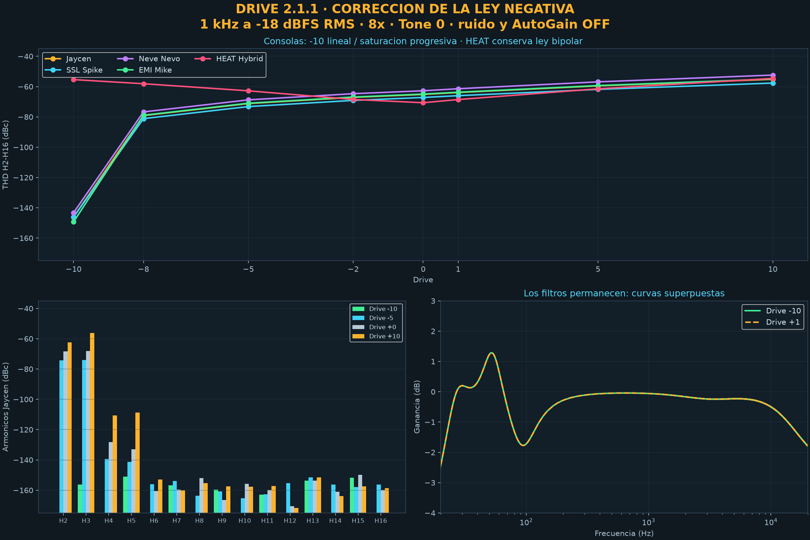
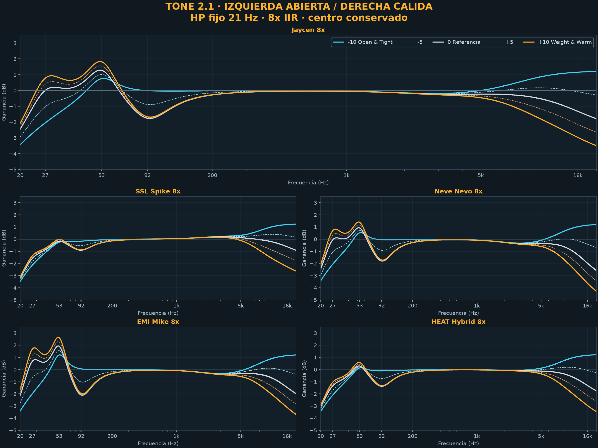
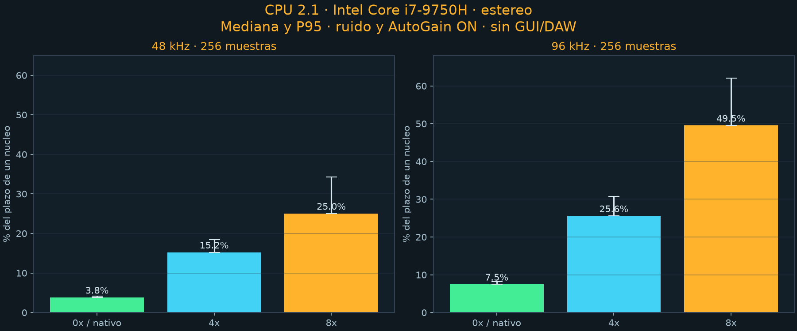
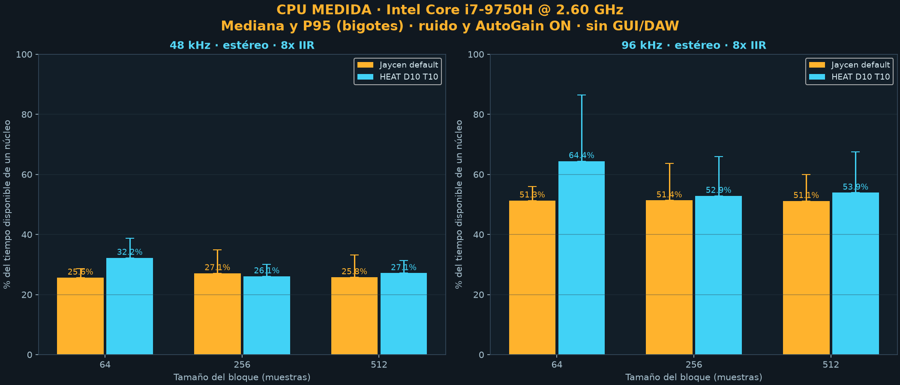

# Summing Console — PAPIELGUAPO 2.3.2

Windows x64 VST3 and Standalone console processor built with C++17 and JUCE 8.0.4. Eight serial stages use the Jaycen-inspired order **Mike (+0.5 dB Drive) → Mike → Mike → Mike → Mike → Spike → Spike → Nevo (−2 dB Trim)**. Jaycen counts 4–8 retain Mike #1 and slots 6–8, successively bypassing Mike #5 through #2 as the count falls. Counts 1–3 audition the first stages. The header cycles 8, 6 and 4 in Jaycen mode. Disable AutoGain to hear the absolute output trim. Jaycen is the sole processor bank. Sessions saved with earlier banks reopen on Jaycen.

Version 2 replaces the envelope-normalized Chebyshev exciter with a fixed-reference, biased soft saturation transfer. This is an original, reference-inspired model. Commercial NLS/HEAT equivalence has **not** been established by reference measurements.

The independent Jaycen model uses per-slot, per-channel filter fits and nonlinear residuals measured from the local reference project. Waves binaries and preset chunks are not distributed. Right-click to toggle Mike 2–5 individually. Their bypass states are saved per session. AutoGain starts off to preserve the reference output level. See Measurements/v2.3.0/waves-vs-model.csv for residual errors. The Jaycen bank has its own Drive/Tone map in 2.3.0. Drive reads −10 to +10 in saved automation (0–100% travel). At minimum all eight stages retain their undriven nonlinear response. At midpoint Mike 1 has +0.5 dB excitation. At maximum Mike 1 reaches +2 dB, Mike 2–5 reach +9 dB and Spike 6–7 reach +6 dB, with sequential onsets. Nevo retains −2 dB output trim. Linked AutoGain follows that trimmed reference. At center the measured low-frequency response is preserved. Turning left progressively blends in a 20–32 Hz high-pass and darkens the top by up to 1.5 dB. Turning right retains the low-frequency voicing, applies up to 3 dB pre-emphasis before slot 6 with reciprocal de-emphasis after slot 8, and adds up to 3 dB of air with a 16 kHz shelf. Historical Tone and Drive descriptions below describe the earlier mapping and the other console banks.

## DSP architecture

```
Input → selected-rate domain (native 0x, 4x or 8x IIR)
      → 21 Hz first-order subsonic HP
      → Tone pre-emphasis
      → [minimum-phase impedance filters → biased saturation] × 8
      → reciprocal de-emphasis → controlled air shelf
      → 5 Hz first-order DC blocker → stereo-linked RMS AutoGain
      → downsampler when enabled → latency-aligned bypass crossfade → Output
```

* **Single cascade domain:** all eight stages run together at the selected rate. Right-click selects **0x / zero latency** (native 1x, no oversampling), **4x** (lower CPU) or **8x** (default). Native mode adds zero samples of processing delay but produces more aliasing when driven. Legacy 2x settings migrate to 4x. The 4x and 8x paths each use one upsampler before stage 1 and one downsampler after stage 8; native mode performs no sample-rate conversion. Latency is integer compensated and reported in `prepareToPlay`, never changed from the audio callback. Finite oversampling reduces aliasing; it cannot mathematically eliminate every alias component.
* **Stage interaction:** five minimum-phase biquads precede each nonlinear transfer: high-mid impedance, a controlled 27 Hz resonance, 52.8 Hz punch, a 92 Hz dip, and model-dependent top roll-off. Filter histories survive parameter changes.
* **Sub headroom:** one fixed 6 dB/oct high-pass at 21 Hz prevents infrabass buildup. Tone does not move its cutoff. The output DC blocker remains fixed at 5 Hz.
* **Dual mono:** every stage/channel has deterministic frequency deviations of ±1.0–1.5% and a unique bias. Independent L/R audio states remain uncoupled. AutoGain applies a common gain to both channels and does not force their levels to match.
* **Level calibration:** −18 dBFS RMS is the nominal 0 VU reference. Saturation has unity small-signal slope and a fixed knee; distortion increases with level instead of being normalized to a constant THD. Hot-level measurements distinguish peak from RMS units.
* **Tone (v2.2):** the center retains the v2.0 voicing. Turning left progressively removes the 27 Hz resonance and 92 Hz dip, reduces the 52.8 Hz punch by up to 35%, relaxes the stage top roll-off and adds up to +1.25 dB of 6 kHz air. Turning right adds controlled weight (27 Hz resonance scale held at unity, punch scale up to 1.20) and a gentle 8 kHz shelf down to −1.75 dB, without deepening the dip. The audible shelf uses a gentler slope near the center of the knob. A separate 4.5 kHz pre-emphasis shelf (−2 × normalized Tone dB) and its exact reciprocal after the cascade shape saturation excitation independently of the audible air shelf. HEAT negative Drive continues to favor odd harmonics. The Tone change adds no extra audio filter stages. The three quality domains have their own preallocated storage, with only the selected domain processing audio.
* **Drive correction (v2.1.1):** in Jaycen, SSL, Neve and EMI, the negative range now progressively fades nonlinear contribution from 100% at 0 to exactly 0% at −10. Negative Drive no longer increases saturation excitation through an absolute-value law. At −10 the waveshapers take a strictly linear path while the impedance/Tone filters and optional noise/AutoGain remain available. Positive Drive, including the +1 reference, is unchanged. HEAT retains its original bipolar law and does not become clean at −10. Harmonic measurements must disable optional noise and AutoGain to isolate the nonlinear transfer.
* **AutoGain:** a stereo-linked 120 ms RMS detector with 45 ms gain slewing matches steady signal energy, bounded to ±12 dB. This is RMS compensation, not a promise of instantaneous or LUFS-identical perceived loudness for arbitrary material.

## Real-time behavior

Drive, Tone, AutoGain, bypass, noise, stage enable and model character are smoothed. Tone filter designs run at a bounded control rate; biquad coefficient interpolation retains delay states and uses stable denominator interpolation. Settled filters skip coefficient interpolation, and fixed bias terms are cached.

Oversampling storage and the dry delay ring are allocated in preparation. Oversized host buffers are processed in bounded chunks without resizing or allocating in `processBlock`. Live oversampling changes fade to latency-aligned dry audio for 20 ms, reset the preallocated destination domain, warm it for 40 ms, and fade wet back over 20 ms. Only one quality domain is processed at a time. Host latency stays fixed between 4x and 8x using preallocated wet padding. Native 0x uses no padding and reports zero samples. Switching to/from native changes host PDC: an atomic request is serviced by a message-thread timer; no latency notification or message allocation occurs in the audio callback. Dry-delay interpolation softens the timing transition. The host can also retime other tracks when PDC changes, so quality changes are best made while stopped when exact inter-track alignment matters. Both the plugin switch and host bypass use the same 20 ms latency-aware dry/wet transition; wet DSP continues running while bypassed to preserve state. A settled bypass returns the exact dry signal delayed by the reported latency.

The parameter IDs (`drive`, `sub_punch`, `autogain`, `bypass`), plugin ID and saved skin/editor properties remain compatible. Old sessions will sound different because the DSP transfer and bass response intentionally changed. The six interface skins remain available.

## Drive 2.1.1 — measured correction



Run `JJ8NLSMeasurements.exe captures --drive-only`, then `python Tests/analyse_drive.py captures Measurements/drive_v2.1.1`. The runner checks eight Drive positions, positive-drive compatibility, HEAT bipolar compatibility and preservation of the small-signal filter response at the clean endpoint.

## Tone 2.1 — measured endpoints




The v2.1 full-processor benchmark at the preserved +1 Drive reference, on the i7-9750H, stereo at 256 samples with noise and AutoGain on:

| Host rate | 0x native | 4x | 8x |
| --- | --- | --- | --- |
| 48 kHz | 3.8% | 15.2% | 25.0% |
| 96 kHz | 7.5% | 25.6% | 49.5% |

Values are median single-core audio deadline use, excluding GUI/DAW/driver overhead. Native mode saves about 85% of DSP time versus 8x in this test, with increased aliasing. The smooth bypass keeps DSP active. Zero latency refers to added processor buffering, not the phase/group delay of its causal analog-style filters.

Run `JJ8NLSMeasurements.exe captures --tone-only`, then `python Tests/analyse_tone.py captures Measurements/tone_v2.1` to verify five variants at Tone −10/−5/0/+5/+10, center identity against the captured v2.0 DSP, steady-state AutoGain and endpoint aliasing. The archived v2.0 engine used by these checks is `Tests/ToneBaselineDSP.h`.

## Archived v2.0 measurements

The following plots and CPU measurements document v2.0. Its Tone-center response is preserved by v2.1; the old endpoint curves describe the previous Tone behavior.




Measured on an Intel Core i7-9750H, stereo at 256 samples, noise and AutoGain enabled:

| Host rate | Median single-core audio deadline | P95 |
| --- | --- | --- |
| 48 kHz | 26–27% per instance | 30–35% |
| 96 kHz | 51–53% per instance | 64–66% |

This is a demanding bus/master processor. Smooth bypass keeps processing and does not reduce CPU use. The benchmark excludes GUI, audio driver and DAW overhead; full results include 64/256/512 sample blocks in `Measurements/cpu.csv`.

Measurements are produced by the C++ offline runner from rendered floating-point audio, not drawn from model coefficients or third-party screenshots. The legacy comparison is an exact snapshot of the previous DSP header, using the former default 4x quality; the new chain uses 8x.

* Host rate: 48 kHz; stereo; eight stages; Drive +1, Tone 0 except explicitly labeled cases.
* Small-signal response: −80 dBFS impulse, two-second capture, noise and AutoGain disabled.
* Harmonics: coherent 1 kHz sine, one-second warm-up and one-second capture; H2–H16 relative to H1 (dBc). Nominal input is −18 dBFS RMS; hot tests use −6 and −3 dBFS **peak**.
* Tone: −10 and +10. HEAT: Drive −8/+8 with Tone +10.
* Aliasing diagnostic: coherent 11 kHz at −3 dBFS peak, Drive/Tone +10, compared at 1x (test-only), 8x and 16x (test-only). Folded-harmonic energy excludes the genuine 11 kHz fundamental and 22 kHz second harmonic.
* Regression checks: mono/stereo at 44.1/48/96/192 kHz, abrupt automation, oversized blocks, latency-aligned bypass, block-partition invariance and zero `operator new/new[]` calls in the callback. Allocation instrumentation covers C++ `new`, alongside a source audit of JUCE buffer allocation sites; it does not interpose every Windows/CRT heap API.
* CPU tests: full processor, stereo, noise and AutoGain on, no GUI/device/DAW overhead. Median and P95 wall time are divided by the audio block deadline. These are single-core callback utilization figures, not whole-system CPU percentages.

See `Measurements/mediciones.json`, `mediciones.csv`, `cpu.csv` and the test logs for measured values. Measurements characterize this implementation; hardware/proprietary-plugin matching and DAW listening comparisons remain separate validation tasks.

## Build

```powershell
cmake -S . -B build -G "Visual Studio 18 2026" -DJJ8NLS_BUILD_TESTS=ON
cmake --build build --config Release --target JJ8NLS_VST3 JJ8NLS_Standalone JJ8NLSMeasurements --parallel 4
ctest --test-dir build -C Release --output-on-failure
```

The project reuses the existing local JUCE checkout when available and otherwise fetches JUCE 8.0.4. If Visual Studio's debug helper-tool bootstrap is unavailable, pass `-DJJ8NLS_JUCEAIDE="absolute/path/to/an/existing/juceaide.exe"` to reuse a compatible installed helper.

```powershell
# Run only processor regressions or CPU benchmarks:
.\build\JJ8NLSMeasurements_artefacts\Release\JJ8NLSMeasurements.exe .\captures --regressions-only
.\build\JJ8NLSMeasurements_artefacts\Release\JJ8NLSMeasurements.exe .\captures --bench
# Tone 2.1 and quality checks, plus the current plots:
.\build\JJ8NLSMeasurements_artefacts\Release\JJ8NLSMeasurements.exe .\captures --tone-only
python Tests/analyse_tone.py captures Measurements/tone_v2.1
# Full runner (default) includes the regressions and audio captures:
.\build\JJ8NLSMeasurements_artefacts\Release\JJ8NLSMeasurements.exe .\captures
python -m pip install numpy matplotlib
python Tests/analyse.py captures Measurements
```

## Install

Copy the complete `Summing Console - Papielguapo.vst3` bundle to a VST3 folder scanned by your DAW. The Standalone `.exe` can run independently. Keep the bundle structure intact. A separate build directory preserves previous binaries; this repository does not install plugins into system folders automatically.

The model and console names describe reference-inspired signal character. They do not imply affiliation, endorsement, or verified identity with Waves, Avid, Crane Song, SSL, EMI or Neve.

Version 2.3.1 balances the Jaycen stereo output with fixed, opposite gain trims derived from each active insert at 1 kHz. The calibration follows the Mike switches with a 30 ms transition. The context menu contains Oversampling, Skins, Noise and Active Mike inserts.
