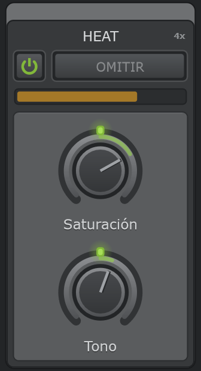

# 🎚️ Summing Console - PAPIELGUAPO

**Recreación en VST3 (64-bit) y Aplicación Standalone (.EXE) para Windows del truco de baterías y buses de Jaycen Joshua con 8 consolas analógicas NLS Buss en serie (`Mike` / `Spike` / `Nevo`), con Sub+Mid L=R Locked (`0.00 dB` de desvío estéreo), techo dinámico anti-rotura a cualquier nivel de entrada, AutoGain RMS estéreo y 2 skins intercambiables (FL Studio Dark Mixer UI & Pro Tools HEAT 1:1) por [papielguapo](https://github.com/papielguapo).**

---

## 🖼️ Vista de Skins: FL Studio Dark Mixer & Pro Tools HEAT 1:1

Haz **clic derecho** en cualquier parte del plugin para cambiar al instante entre las **2 skins** (la elección y el tamaño se guardan con tu proyecto/sesión):

| **Skin 1: FL Studio (Dark Mixer UI)** | **Skin 2: Pro Tools HEAT 1:1 (Original)** |
| :---: | :---: |
|  |  |
| Chasis oscuro estilo mezclador de FL Studio (`#262A2E`), cabecera limpia **`SUMM`** con LED armónico reactivo, botón **`AG` / `RAW`** de AutoGain, controles **`DRIVE`** y **`SUB`** y switch **`ACTIVE` / `BYPASS`**. | Recreación 1:1 de la tira HEAT de Pro Tools con botón **`[⏻]`** (LED verde = AutoGain activo), interruptor **`OMITIR`** iluminado en ámbar, barra de actividad armónica y controles **`Saturación`** y **`Sub 27Hz`**. |

---

## 📊 Análisis en PluginDoctor (Armónicos `H2..H16` + Respuesta `27 Hz` L=R Clavada)


### Escalera Armónica Pares + Impares (`THD = -34.3 dB` / `THD+N = -34.4 dB`)


---

## 🧠 Qué hace el Motor DSP (`Source/DSP/JJ8NLSDSP.h`)

1. **Cadena Fija por Defecto de Jaycen Joshua (8x NLS Buss en serie):**
   - **Instancia 1:** `Mike` (EMI TG12345) — **`Drive = 1.0`**, `Noise = OFF`
   - **Instancia 2:** `Spike` (SSL 4000G) — `Drive = 0.0`, `Noise = OFF`
   - **Instancia 3:** `Mike` (EMI TG12345) — `Drive = 0.0`, `Noise = OFF`
   - **Instancia 4:** `Mike` (EMI TG12345) — `Drive = 0.0`, `Noise = OFF`
   - **Instancia 5:** `Mike` (EMI TG12345) — `Drive = 0.0`, `Noise = OFF`
   - **Instancia 6:** `Spike` (SSL 4000G) — `Drive = 0.0`, `Noise = OFF`
   - **Instancia 7:** `Nevo` (Neve 5116) — `Drive = 0.0`, `Noise = OFF`
   - **Instancia 8:** `Mike` (EMI TG12345) — `Drive = 0.0`, **`Noise = ON`**
2. **Sub + Mid Match L=R Clavado (`0.00 dB` de desvío entre Izquierda y Derecha):**
   - En el truco original con 8 instancias seguidas, las tolerancias analógicas acumulaban más de `1.1 dB` de diferencia entre L y R y desplazaban el golpe de subgrave (`20–40 Hz`) hacia un lado del medidor.
   - **Summing Console** clava exactamente a **`0.00 dB`** la resonancia de transformador de **`+6.2 dB @ 27 Hz`** y todo el rango medio/agudo en ambos canales (`L = R`), mientras conserva el carácter micro-estéreo en los armónicos superiores (`H4..H16`).
3. **Techo Dinámico por Etapa (Sin rotura aunque la señal entre a `0 dBFS`):**
   - Cada una de las 8 consolas incorpora un detector de techo de ataque instantáneo y relajación suave (`500 ms`) que mantiene el argumento de la serie armónica Chebyshev `T2..T16` dentro de su rango óptimo sin importar si entras a `-18 dBFS`, `-6 dBFS` o `0 dBFS`.
4. **AutoGain Estéreo Enlazado (`AG` / `[⏻]`):**
   - Compensa automáticamente el empuje del transformador de `+6.2 dB @ 27 Hz` y el incremento de `Drive` calculando la potencia RMS estéreo combinada (`L+R`), manteniendo el balance estéreo `0.00 dB` intacto y con puerta de silencio a `-60 dBFS`.

---

## 🎚️ Controles y Atajos Rápidos

| Control | Rango | Por Defecto (Preset JJ) | Descripción |
| :--- | :---: | :---: | :--- |
| **DRIVE (`Saturación`)** | `0.0` a `12.0` | **`1.0`** | Drive de la cadena de 8 consolas (en `1.0` replica el ajuste exacto de Jaycen Joshua). **Doble clic** en el valor/etiqueta para volver a `1.0`. |
| **SUB (`Sub 27Hz`)** | `-6.0 dB` a `+6.0 dB` | **`0.0 dB`** | Ajusta el golpe de transformador de `27 Hz` respecto a la curva 1:1 (`0.0 dB` = `+6.2 dB @ 27 Hz` original). **Doble clic** para volver a `0.0 dB`. |
| **AG / RAW (`[⏻]`)** | `ON` / `OFF` | **`ON` (`AG`)** | Activa o desactiva la compensación automática de ganancia RMS estéreo. |
| **ACTIVE / BYPASS (`OMITIR`)** | `Active` / `Bypass` | **`Active`** | Bypass suave libre de clics. |
| **Menú Contextual** | *Clic Derecho* | — | Cambia entre **Skin 1: FL Studio (Dark Mixer UI)** y **Skin 2: Pro Tools HEAT 1:1**, activa/desactiva **AutoGain**, restaura el **Preset Jaycen Joshua** o cambia el tamaño de ventana. |

---

## 🚀 Instalación Rápida (Windows x64)

1. Copia la carpeta **`Summing Console - Papielguapo.vst3`** dentro de:
   ```text
   C:\Program Files\Common Files\VST3\
   ```
2. **Versión Standalone (.EXE):**
   Ejecuta directamente **`Summing Console - Papielguapo.exe`** sin necesidad de abrir un DAW.

---

## 🛠️ Compilación desde el Código Fuente (CMake + JUCE 8 + Visual Studio)

```powershell
cmake -S . -B build -G "Visual Studio 18 2026" -A x64
cmake --build build --config Release --parallel 8
```

---

## 👤 Créditos

- **Desarrollador:** **[papielguapo](https://github.com/papielguapo)** (`COMPANY_NAME = "papielguapo"`)
