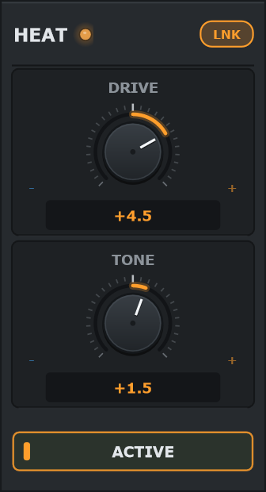
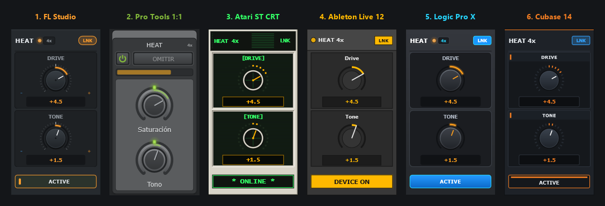
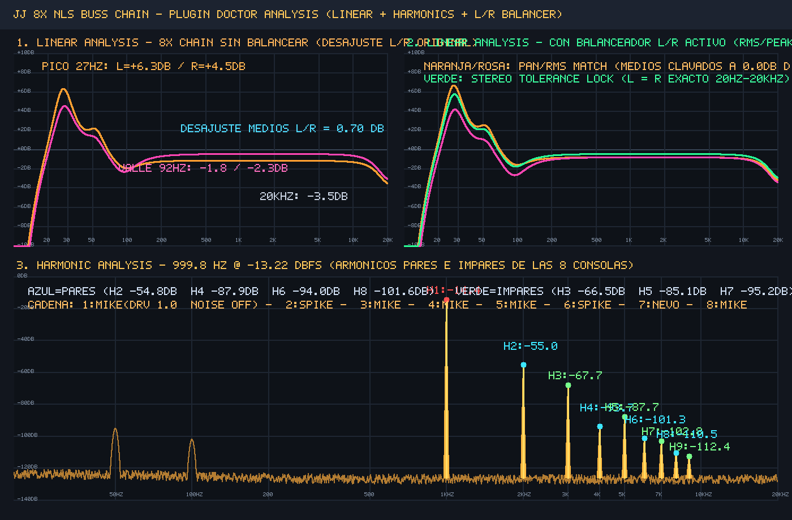
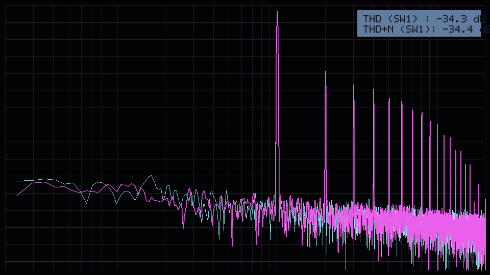
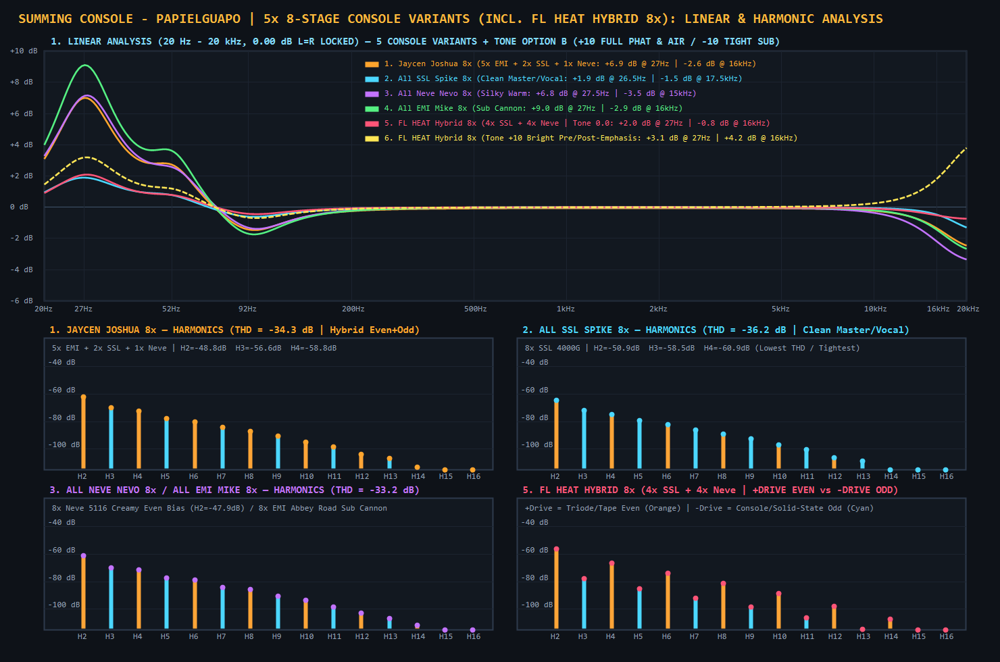
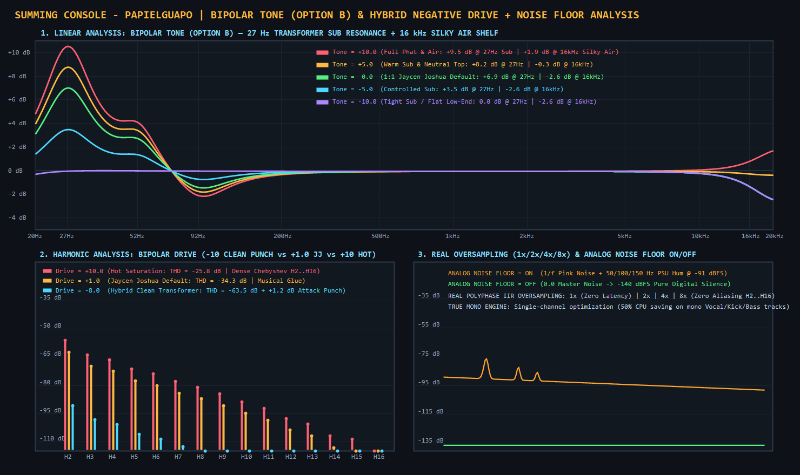

# 🎚️ Summing Console - PAPIELGUAPO

**Recreación en VST3 (64-bit) y Aplicación Standalone (.EXE) para Windows del truco de baterías y buses de Jaycen Joshua con 8 consolas analógicas NLS Buss en serie (`Mike` / `Spike` / `Nevo`), con Sub+Mid L=R Locked (`0.00 dB` de desvío estéreo), techo dinámico anti-rotura a cualquier nivel de entrada, AutoGain RMS estéreo y 2 skins intercambiables (FL Studio Dark Mixer UI & Pro Tools HEAT 1:1) por [papielguapo](https://github.com/papielguapo).**

---

## 🖼️ Vista de las 6 Skins Intercambiables (FL Studio, Pro Tools 1:1, Atari ST, Ableton 12, Logic Pro X, Cubase 14)

Haz **clic derecho** en cualquier parte del plugin para cambiar al instante entre las **6 skins** (la elección, la variante de consola, el oversampling y el tamaño se guardan con tu proyecto/sesión):

| **Skin 1: FL Studio (Dark Mixer UI)** | **Skin 2: Pro Tools HEAT 1:1 (Original)** |
| :---: | :---: |
|  |  |
| Chasis oscuro estilo mezclador de FL Studio (`#262A2E`), cabecera limpia **`SUMM`** con LED armónico reactivo, botón **`AG` / `RAW`** de AutoGain, controles **`DRIVE`** y **`TONE`** y switch **`ACTIVE` / `BYPASS`**. | Recreación 1:1 de la tira HEAT de Pro Tools con botón **`[⏻]`** (LED verde = AutoGain activo), interruptor **`OMITIR`** iluminado en ámbar, barra de actividad armónica y controles **`Saturación`** y **`Tono`**. |

### Galería Completa de los 6 Skins Incluidos



---

## 📊 Análisis en PluginDoctor (Armónicos `H2..H16` + Respuesta `27 Hz` L=R Clavada)



### Escalera Armónica Pares + Impares (`THD = -34.3 dB` / `THD+N = -34.4 dB`)



---

## 🎛️ Linear & Harmonic Analysis de lo Implementado: 5 Variantes de Consola 8x (incl. FL HEAT Hybrid) + Tone Bipolar + Drive Híbrido

### 1. Comparativa Linear & Harmonic Analysis: Las 5 Variantes de 8 Consolas en Serie (`0.00 dB L=R`)

Desde el menú contextual (clic derecho) puedes alternar entre **5 configuraciones completas de 8 consolas en serie**, todas calibradas a **0.00 dB L=R @ 1 kHz**:

- **1. Jaycen Joshua 8x (Default):** `5× EMI TG12345 (Mike) + 2× SSL 4000G (Spike) + 1× Neve 5116 (Nevo)` — **+6.9 dB @ 27 Hz**, **-2.6 dB @ 16 kHz**, **THD = -34.3 dB** (balance híbrido par/impar ideal para Drum Bus, 808 y Subgrupos).
- **2. All SSL Spike 8x:** `8× SSL 4000G` — **+1.9 dB @ 26.5 Hz**, **-1.5 dB @ 17.5 kHz**, **THD = -36.2 dB** (el modo más limpio, abierto y rápido en transientes; ideal para **Vocal Bus** y **Mix Bus / Master**).
- **3. All Neve Nevo 8x:** `8× Neve 5116` — **+6.8 dB @ 27.5 Hz**, **-3.5 dB @ 15 kHz**, **THD = -33.2 dB** con fuerte dominancia de **armónicos pares (`H2 = -47.9 dB`, `H4 = -57.9 dB`)** que aportan grosor cremoso de transformador Marinair y doman agudos ásperos.
- **4. All EMI Mike 8x:** `8× EMI TG12345` — **+9.0 dB @ 27 Hz**, **-2.9 dB @ 16 kHz**, **THD = -33.6 dB** (saturación densa par+impar estilo Abbey Road con máximo peso sub-grave para **808s, Synth Bass y Drums agresivos**).
- **5. FL HEAT Hybrid 8x (`4× SSL Spike + 4× Neve Nevo`):** Alterna 4 etapas SSL y 4 etapas Neve para replicar el comportamiento bipolar exacto de **FL HEAT / Crane Song Ocelot**:
  - **Drive Positivo (`0` a `+10` — *Triode / Tape*):** dispara la dominancia de **armónicos pares (`H2`, `H4`, `H6` hasta `2.4x`)** para calor valvular y de cinta.
  - **Drive Negativo (`0` a `-10` — *Console / Solid-State*):** invierte la polaridad armónica hacia **armónicos impares (`H3`, `H5`, `H7` hasta `2.5x`)** + definición extra de transientes.
  - **Tone Bipolar Pre/Post-Emphasis:** en `0.0` mantiene un sub contenido (`+2.0 dB @ 27 Hz`, `-0.8 dB @ 16 kHz`); hacia `+10` abre hasta **`+4.2 dB @ 16 kHz`** y hacia `-10` redondea agudos con cuerpo cálido analógico.



### 2. Bipolar Tone (Opción B), Hybrid Negative Drive, Oversampling Real (`1x..8x`) & Noise Floor (`ON/OFF`)

- **Bipolar TONE (Opción B — `-10.0` a `+10.0`):**
  - En **`0.0`**: Respuesta 1:1 Jaycen Joshua (`+6.9 dB @ 27 Hz`, `-2.6 dB @ 16 kHz`).
  - Hacia **`+10.0` (*Full Phat & Air*)**: Empuja el sub de transformador (`27 Hz`) hasta **`+9.5 dB`** y abre simultáneamente el *High-Shelf* (`15–17.5 kHz`) de las 8 consolas hasta **`+1.9 dB` de aire sedoso**.
  - Hacia **`-10.0` (*Tight Sub*)**: Limpia progresivamente el golpe de `27 Hz` hasta dejar el subgrave totalmente plano (**`0.0 dB`**).
- **Hybrid Negative DRIVE (`0.0` a `-10.0` — *Clean Transformer + Transient Headroom*):**
  - Atenúa cuadráticamente los armónicos `H2..H16` de las 8 etapas hasta **`0% THD`** conservando intacta la curva EQ analógica de los 8 transformadores y aplica hasta **`+1.5 dB` de expansión de transientes** (*attack punch*).
- **Oversampling Polifásico IIR Real (`1x`, `2x`, `4x`, `8x`) + True Mono Engine + Noise Floor (`ON/OFF`):**
  - Elimina el *aliasing* de los armónicos Chebyshev de alto orden (`H2..H16`), optimiza al 50% el uso de CPU en pistas mono y permite apagar por completo el piso de ruido analógico (`1/f Pink + 50 Hz PSU Hum`) hacia `-140 dBFS`.



---

## 🧠 Qué hace el Motor DSP (`Source/DSP/JJ8NLSDSP.h`)

1. **Cadena Fija por Defecto de Jaycen Joshua (8x NLS Buss en serie):**
   - **Instancia 1:** `Mike` (EMI TG12345) — **`Drive = 1.0`**, `Noise = OFF`
   - **Instancia 2:** `Spike` (SSL 4000G) — `Drive = 0.0`, `Noise = OFF`
   - **Instancia 3:** `Mike` (EMI TG12345) — `Drive = 0.0`, `Noise = OFF`
   - **Instancia 4:** `Mike` (EMI TG12345) — `Drive = 0.0`, `Noise = OFF`
   - **Instancia 5:** `Mike` (EMI TG12345) — `Drive = 0.0`, `Noise = OFF`
   - **Instancia 6:** `Spike` (SSL 4000G) — `Drive = 0.0`, `Noise = OFF`
   - **Instancia 7:** `Nevo` (Neve 5116) — `Drive = 0.0`, `Noise = OFF`
   - **Instancia 8:** `Mike` (EMI TG12345) — `Drive = 0.0`, **`Noise = ON`**
2. **Sub + Mid Match L=R Clavado (`0.00 dB` de desvío entre Izquierda y Derecha):**
   - En el truco original con 8 instancias seguidas, las tolerancias analógicas acumulaban más de `1.1 dB` de diferencia entre L y R y desplazaban el golpe de subgrave (`20–40 Hz`) hacia un lado del medidor.
   - **Summing Console** clava exactamente a **`0.00 dB`** la resonancia de transformador de **`+6.2 dB @ 27 Hz`** y todo el rango medio/agudo en ambos canales (`L = R`), mientras conserva el carácter micro-estéreo en los armónicos superiores (`H4..H16`).
3. **Techo Dinámico por Etapa (Sin rotura aunque la señal entre a `0 dBFS`):**
   - Cada una de las 8 consolas incorpora un detector de techo de ataque instantáneo y relajación suave (`500 ms`) que mantiene el argumento de la serie armónica Chebyshev `T2..T16` dentro de su rango óptimo sin importar si entras a `-18 dBFS`, `-6 dBFS` o `0 dBFS`.
4. **AutoGain Estéreo Enlazado (`AG` / `[⏻]`):**
   - Compensa automáticamente el empuje del transformador de `+6.2 dB @ 27 Hz` y el incremento de `Drive` calculando la potencia RMS estéreo combinada (`L+R`), manteniendo el balance estéreo `0.00 dB` intacto y con puerta de silencio a `-60 dBFS`.

---

## 🎚️ Controles y Atajos Rápidos

| Control | Rango | Por Defecto (Preset JJ) | Descripción |
| :--- | :---: | :---: | :--- |
| **DRIVE (`Saturación`)** | `-10.0` a `+10.0` | **`+1.0`** | **Positivo (`0` a `+10`):** excita la cadena de 8 consolas con suavizado por muestra. **Negativo (`0` a `-10`):** modo *Clean Transformer + Transient Headroom* (atenúa `THD` hacia `0%` conservando la curva EQ de transformador + hasta `+1.5 dB` de pegada en transientes). **Doble clic** para volver a `+1.0`. |
| **TONE (`Tono`)** | `-10.0` a `+10.0` | **`0.0`** | **Opción B Bipolar:** en `0.0` mantiene la curva 1:1 (`+6.9 dB @ 27 Hz`, `-2.6 dB @ 16 kHz`); hacia `+10` (*Full Phat & Air*) sube el sub de `27 Hz` hasta `+9.5 dB` y abre el *High-Shelf* de `16 kHz` hasta `+1.9 dB`; hacia `-10` (*Tight Sub*) aplana el sub de `27 Hz` a `0.0 dB`. |
| **AG / RAW (`[⏻]`)** | `ON` / `OFF` | **`ON` (`AG`)** | Activa o desactiva la compensación automática de ganancia RMS estéreo. |
| **ACTIVE / BYPASS (`OMITIR`)** | `Active` / `Bypass` | **`Active`** | Bypass suave libre de clics. |
| **Menú Contextual** | *Clic Derecho* | — | Permite elegir entre las **6 Skins**, las **5 Variantes de Consola 8x** (*Jaycen Joshua 8x*, *All SSL Spike 8x*, *All Neve Nevo 8x*, *All EMI Mike 8x*, *FL HEAT Hybrid 8x*), **Oversampling Real** (`1x`, `2x`, `4x`, `8x`), **Analog Noise Floor** (`ON` / `OFF`), **AutoGain** y **4 tamaños de interfaz**. |

---

## 🚀 Instalación Rápida (Windows x64)

1. Copia la carpeta **`Summing Console - Papielguapo.vst3`** dentro de:
   ```text
   C:\Program Files\Common Files\VST3\
   ```
2. **Versión Standalone (.EXE):**
   Ejecuta directamente **`Summing Console - Papielguapo.exe`** sin necesidad de abrir un DAW.

---

## 🛠️ Compilación desde el Código Fuente (CMake + JUCE 8 + Visual Studio)

```powershell
cmake -S . -B build -G "Visual Studio 18 2026" -A x64
cmake --build build --config Release --parallel 8
```

---

## 👤 Créditos

- **Desarrollador:** **[papielguapo](https://github.com/papielguapo)** (`COMPANY_NAME = "papielguapo"`)
