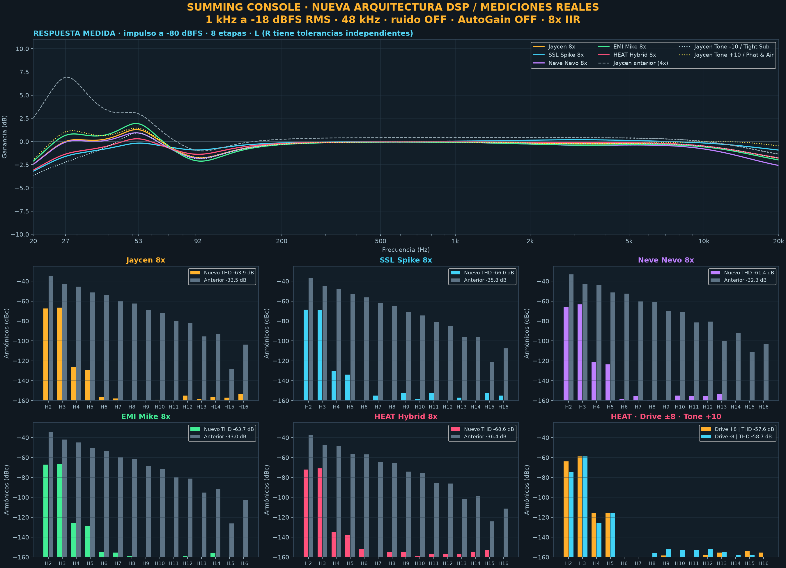
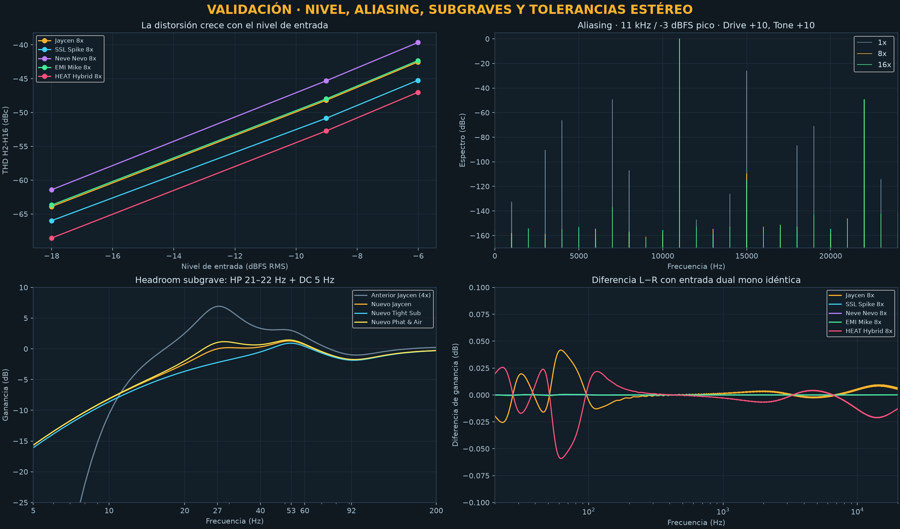

# Summing Console — PAPIELGUAPO 2.0

Windows x64 VST3 and Standalone console processor built with C++17 and JUCE 8.0.4. Eight serial stages use the Jaycen-inspired order **Mike → Spike → Mike → Mike → Mike → Spike → Nevo → Mike**. Alternative banks provide all-Spike, all-Nevo, all-Mike and alternating Spike/Nevo HEAT Hybrid character.

Version 2 replaces the envelope-normalized Chebyshev exciter with a fixed-reference, biased soft saturation transfer. This is an original, reference-inspired model. Commercial NLS/HEAT equivalence has **not** been established by reference measurements.

## DSP architecture

```
Input → one 8x IIR upsampler
      → 21–22 Hz first-order subsonic HP
      → Tone pre-emphasis
      → [minimum-phase impedance filters → biased saturation] × 8
      → reciprocal de-emphasis → controlled air shelf
      → 5 Hz first-order DC blocker → stereo-linked RMS AutoGain
      → one downsampler → latency-aligned bypass crossfade → Output
```

* **Single oversampled domain:** all eight stages run at 8 × the host sample rate. Quality is fixed at 8x; legacy 1x/2x/4x state settings migrate to 8x. Latency is integer compensated and reported in `prepareToPlay`, never changed from the audio callback. Finite oversampling reduces aliasing; it cannot mathematically eliminate every alias component.
* **Stage interaction:** five minimum-phase biquads precede each nonlinear transfer: high-mid impedance, a controlled 27 Hz resonance, 52.8 Hz punch, a 92 Hz dip, and model-dependent top roll-off. Filter histories survive parameter changes.
* **Sub headroom:** one 6 dB/oct high-pass at 21 Hz (22 Hz at Tone −10) prevents the old stacked infrabass boost. Tight Sub removes the controlled 27 Hz resonance while retaining the 40–60 Hz punch and 92 Hz dip. A separate 5 Hz DC blocker follows stage 8.
* **Dual mono:** every stage/channel has deterministic frequency deviations of ±1.0–1.5% and a unique bias. Independent L/R audio states remain uncoupled. AutoGain applies a common gain to both channels and does not force their levels to match.
* **Level calibration:** −18 dBFS RMS is the nominal 0 VU reference. Saturation has unity small-signal slope and a fixed knee; distortion increases with level instead of being normalized to a constant THD. Hot-level measurements distinguish peak from RMS units.
* **Tone:** positive Tone raises a 4.5 kHz shelf ahead of saturation (up to +4 dB), applies its exact reciprocal after the cascade, then adds a proportional 12 kHz air shelf (up to +1.5 dB). The reciprocal pair is exact at settled coefficients, before nonlinear processing. Negative Tone tightens the sub. HEAT negative Drive reduces even bias to emphasize odd harmonics.
* **AutoGain:** a stereo-linked 120 ms RMS detector with 45 ms gain slewing matches steady signal energy, bounded to ±12 dB. This is RMS compensation, not a promise of instantaneous or LUFS-identical perceived loudness for arbitrary material.

## Real-time behavior

Drive, Tone, AutoGain, bypass, noise, stage enable and model character are smoothed. Tone filter designs run at a bounded control rate; biquad coefficient interpolation retains delay states and uses stable denominator interpolation. Settled filters skip coefficient interpolation, and fixed bias terms are cached.

Oversampling storage and the dry delay ring are allocated in preparation. Oversized host buffers are processed in bounded chunks without resizing or allocating in `processBlock`. Both the plugin switch and host bypass use the same 20 ms latency-aware dry/wet transition; wet DSP continues running while bypassed to preserve state. A settled bypass returns the exact dry signal delayed by the reported latency.

The parameter IDs (`drive`, `sub_punch`, `autogain`, `bypass`), plugin ID and saved skin/editor properties remain compatible. Old sessions will sound different because the DSP transfer and bass response intentionally changed. The six interface skins remain available.

## Measurements





Measured on an Intel Core i7-9750H, stereo at 256 samples, noise and AutoGain enabled:

| Host rate | Median single-core audio deadline | P95 |
| --- | --- | --- |
| 48 kHz | 26–27% per instance | 30–35% |
| 96 kHz | 51–53% per instance | 64–66% |

This is a demanding bus/master processor. Smooth bypass keeps processing and does not reduce CPU use. The benchmark excludes GUI, audio driver and DAW overhead; full results include 64/256/512 sample blocks in `Measurements/cpu.csv`.

Measurements are produced by the C++ offline runner from rendered floating-point audio, not drawn from model coefficients or third-party screenshots. The legacy comparison is an exact snapshot of the previous DSP header, using the former default 4x quality; the new chain uses 8x.

* Host rate: 48 kHz; stereo; eight stages; Drive +1, Tone 0 except explicitly labeled cases.
* Small-signal response: −80 dBFS impulse, two-second capture, noise and AutoGain disabled.
* Harmonics: coherent 1 kHz sine, one-second warm-up and one-second capture; H2–H16 relative to H1 (dBc). Nominal input is −18 dBFS RMS; hot tests use −6 and −3 dBFS **peak**.
* Tone: −10 and +10. HEAT: Drive −8/+8 with Tone +10.
* Aliasing diagnostic: coherent 11 kHz at −3 dBFS peak, Drive/Tone +10, compared at 1x (test-only), 8x and 16x (test-only). Folded-harmonic energy excludes the genuine 11 kHz fundamental and 22 kHz second harmonic.
* Regression checks: mono/stereo at 44.1/48/96/192 kHz, abrupt automation, oversized blocks, latency-aligned bypass, block-partition invariance and zero `operator new/new[]` calls in the callback. Allocation instrumentation covers C++ `new`, alongside a source audit of JUCE buffer allocation sites; it does not interpose every Windows/CRT heap API.
* CPU tests: full processor, stereo, noise and AutoGain on, no GUI/device/DAW overhead. Median and P95 wall time are divided by the audio block deadline. These are single-core callback utilization figures, not whole-system CPU percentages.

See `Measurements/mediciones.json`, `mediciones.csv`, `cpu.csv` and the test logs for measured values. Measurements characterize this implementation; hardware/proprietary-plugin matching and DAW listening comparisons remain separate validation tasks.

## Build

```powershell
cmake -S . -B build -G "Visual Studio 18 2026" -DJJ8NLS_BUILD_TESTS=ON
cmake --build build --config Release --target JJ8NLS_VST3 JJ8NLS_Standalone JJ8NLSMeasurements --parallel 4
ctest --test-dir build -C Release --output-on-failure
```

The project reuses the existing local JUCE checkout when available and otherwise fetches JUCE 8.0.4. If Visual Studio's debug helper-tool bootstrap is unavailable, pass `-DJJ8NLS_JUCEAIDE="absolute/path/to/an/existing/juceaide.exe"` to reuse a compatible installed helper.

```powershell
# Run only processor regressions or CPU benchmarks:
.\build\JJ8NLSMeasurements_artefacts\Release\JJ8NLSMeasurements.exe .\captures --regressions-only
.\build\JJ8NLSMeasurements_artefacts\Release\JJ8NLSMeasurements.exe .\captures --bench
# Full runner (default) includes the regressions and audio captures:
.\build\JJ8NLSMeasurements_artefacts\Release\JJ8NLSMeasurements.exe .\captures
python -m pip install numpy matplotlib
python Tests/analyse.py captures Measurements
```

## Install

Copy the complete `Summing Console - Papielguapo.vst3` bundle to a VST3 folder scanned by your DAW. The Standalone `.exe` can run independently. Keep the bundle structure intact. A separate build directory preserves previous binaries; this repository does not install plugins into system folders automatically.

The model and console names describe reference-inspired signal character. They do not imply affiliation, endorsement, or verified identity with Waves, Avid, Crane Song, SSL, EMI or Neve.
